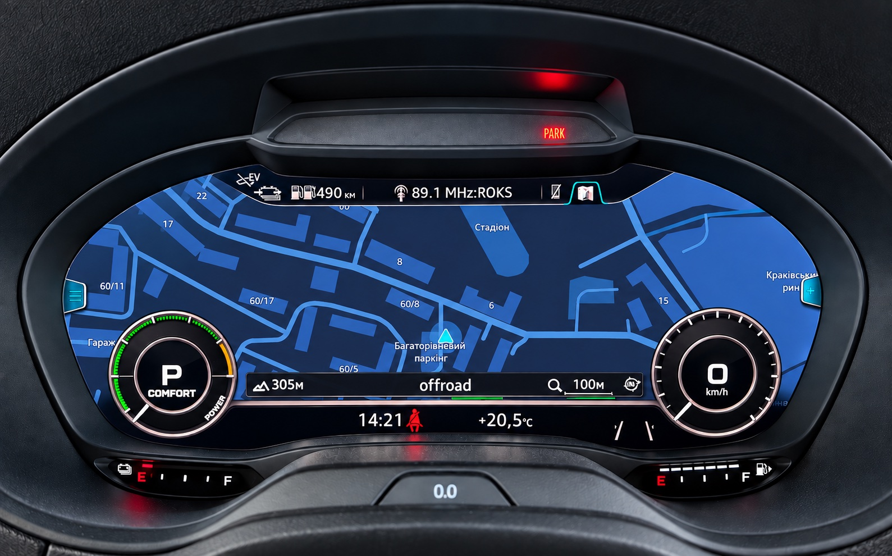

# MHI2 AU37x CarPlay patches

CarPlay additions for Audi MHI2 head units on the **`MHI2_ER_AU37x`** train:

- **CarPlay map in the Virtual Cockpit** — the phone's own navigation map (Apple Maps,
  Google Maps, Waze) in the cluster in place of the stock one, 30 fps, decoded by the
  head unit's video hardware. Follows the cluster's large, Sport and Classic views.
- **Route guidance** — CarPlay turn-by-turn maneuvers in the cluster's maneuver tile:
  the arrow, the distance, the street and lane guidance, drawn live in 3D.
- **Cover art** — CarPlay album artwork on the cluster's now-playing widget.
- **Touchpad → D-pad** — the MMI touchpad navigates CarPlay menus.
- **Phone tab in the cluster** — CarPlay calls in the cluster's phone tab as with a
  Bluetooth phone: caller, call state and timer, accept, end, hold, mute, recents and
  favourites, signal and carrier. The **Tel** key and the phone menu go straight to
  CarPlay, and a **short press of the voice key** starts Siri.
- **Parking sensors over CarPlay** — the side sensors open their small popup beside
  CarPlay instead of taking the whole screen. Installed by default on the firmware it
  was checked against (P5089, Q2 P5088).

Prebuilt binaries, installed from an M.I.B. SD card or over a network cable.

> **Use at your own risk.** Everything is reversible, but read
> [Recovery](https://github.com/chefranov/mhi2-au37x-carplay/wiki/Troubleshooting#recovery)
> before you start.

<p align="center"></p>
<p align="center"></p>
<p align="center"></p>
<p align="center"></p>

## Compatibility

Tested on `MHI2_ER_AU37x_P5089`, `MU1326`, part `8V1035036A` — Audi A3 8V with the
Virtual Cockpit and the HARMAN iAP2 stack. Other `MHI2_ER_AU37x_*` builds are expected
to work but are not verified: **[read Compatibility before installing](https://github.com/chefranov/mhi2-au37x-carplay/wiki/Compatibility)**.

Audi Q2 (`MHI2_*_AU276_*`) runs the same HMI classes, and the release is confirmed
working on a Q2. The installer checks the firmware train first and stops, changing
nothing, on anything that is not `MHI2_*_AU37x_*` or `MHI2_*_AU276_*`. Other trains
carry other versions of the HMI classes these patches replace, and installing there
can leave the main screen black.
If another CarPlay mod is installed on the unit, remove it first.

- **CarPlay map in the cluster** needs the iPhone **by cable** — wireless CarPlay
  adapters do not pass the cluster stream.
- **Cover art** needs module **17**, adaptation `Picture_Upload_Download` = **active**.
- **Route guidance** works with Apple Maps and Google Maps. Waze sends no turn-by-turn
  data over CarPlay; its map still shows in the cluster.
- **D-pad** is self-contained: `bin/dpad_hook.jar` alone in `/mnt/app/eso/hmi/lsd/jars/`.

## Install

Download the `…-sd.zip` of the latest release from
**[Releases](https://github.com/chefranov/mhi2-au37x-carplay/releases)**. What changed in
each release is listed there and in the [CHANGELOG](CHANGELOG.md).

**From an SD card (M.I.B.):**

1. Unpack the archive. It contains a single folder, `mod`.
2. Copy that `mod` folder to the root of an empty FAT32 card. Eject the card safely.
   Don't drag it over an existing `mod` folder on a Mac: Finder replaces the folder, it
   doesn't merge them.
3. Insert the card, then in M.I.B. run `Advanced Settings → Run Custom Script`. On
   M.I.B. V3.6 and later the item is `Advanced Settings → Run individual script`.
4. Read the log on screen, then **reboot the unit** (see below).

**Over a network cable:** unpack the archive, then from the folder that contains `mod`:

```sh
ssh root@172.16.250.248 'mount -uw /mnt/app; mkdir -p /mnt/app/root/carplay'
scp -O -r mod/carplay/* root@172.16.250.248:/mnt/app/root/carplay/
ssh root@172.16.250.248 'sh /mnt/app/root/carplay/install.sh'
```

**Reboot.** The patches load only after a reboot. Hold the button combination for your
MMI until the screen goes dark. On the A3/S3 8V that is **NAV/MAP + RADIO + the big
rotary knob**. Over SSH: `on -f rcc /usr/apps/mib2_ioc_flash reboot`.

Running the installer again upgrades in place.

**Before installing, the installer checks:**

- **The firmware train.** On anything other than `MHI2_*_AU37x_*` or `MHI2_*_AU276_*` it
  stops without changing anything.
- **Other mods.** It stops if MIBSI, another CarPlay mod, or jars it does not know are on
  the unit. Remove the other mod first. M.I.B.'s NavActiveIgnore is switched off, and
  uninstalling switches it back on.

| Option | Cable | SD card (empty file in `mod/carplay/`) |
|---|---|---|
| leave out route guidance and the cluster map | `RGI=0 sh install.sh` | `NO_RGI` |
| leave out only the cluster map | `ALTSCREEN=0 sh install.sh` | `NO_ALTSCREEN` |
| offer the cluster map to a wireless adapter that does not ask for it | `WIRELESS_MAP=1 sh install.sh` | `WIRELESS_MAP` |
| install the parking popup beside CarPlay on firmware other than P5089 / Q2 P5088 | `PDC=1 sh install.sh` | `PDC` |
| let unknown jars through | `IGNORE_CONFLICTS=1 sh install.sh` | `IGNORE_CONFLICTS` |

Step by step, and what gets changed on the unit:
**[Installation](https://github.com/chefranov/mhi2-au37x-carplay/wiki/Installation)**.

## Using it

- **Cluster map**: comes up with the phone, after a short intro. A **long press of the
  left steering-wheel roller** swaps between the CarPlay map and the stock one; the
  choice survives the ignition.
- **Route guidance**: start a route on the phone. Off without uninstalling:
  `touch /mnt/app/rgd_disable` and reboot; delete the file to turn it back on.
- **Siri**: a short press of the voice key on the steering wheel; a long press works as
  before.
- **Sport layout** is detected by itself. To force it: `touch /mnt/app/rgd_sport`
  (`SPORT=1` / an empty `SPORT` file at install time).

Something not right: **[Troubleshooting](https://github.com/chefranov/mhi2-au37x-carplay/wiki/Troubleshooting)**.

## Uninstall

```sh
ssh root@172.16.250.248 'sh /mnt/app/root/carplay/uninstall.sh'
```

or from the card: the release's `…-uninstall-sd.zip`, copied the same way as for the
install, and the same M.I.B. menu item. Reboot.

## Credits

- [luka-dev/mib2q-carplay-rgi](https://github.com/luka-dev/mib2q-carplay-rgi) — the HMI
  patch pattern, the cover-art pipeline, the route-guidance BAP work, the maneuver
  renderer and lane guidance, the cluster phone tab and Siri, and the parking popup,
  here ported to the HARMAN iAP2 stack.
- [Mich795](https://github.com/Mich795) — cover-art fixes from a version of their own.
- [aberbic](https://github.com/aberbic/Audi-MHI2-Virtual-Cockpit-Altscreen-CarPlay-AndroidAuto)
  — the hardware-decoder layer setup that lit the cluster map.
